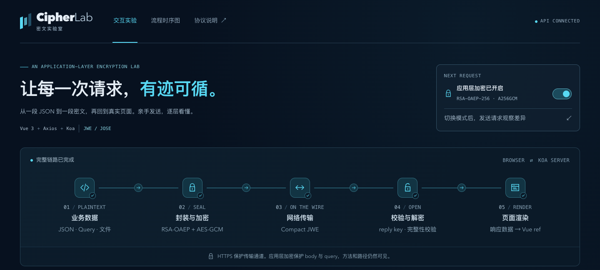
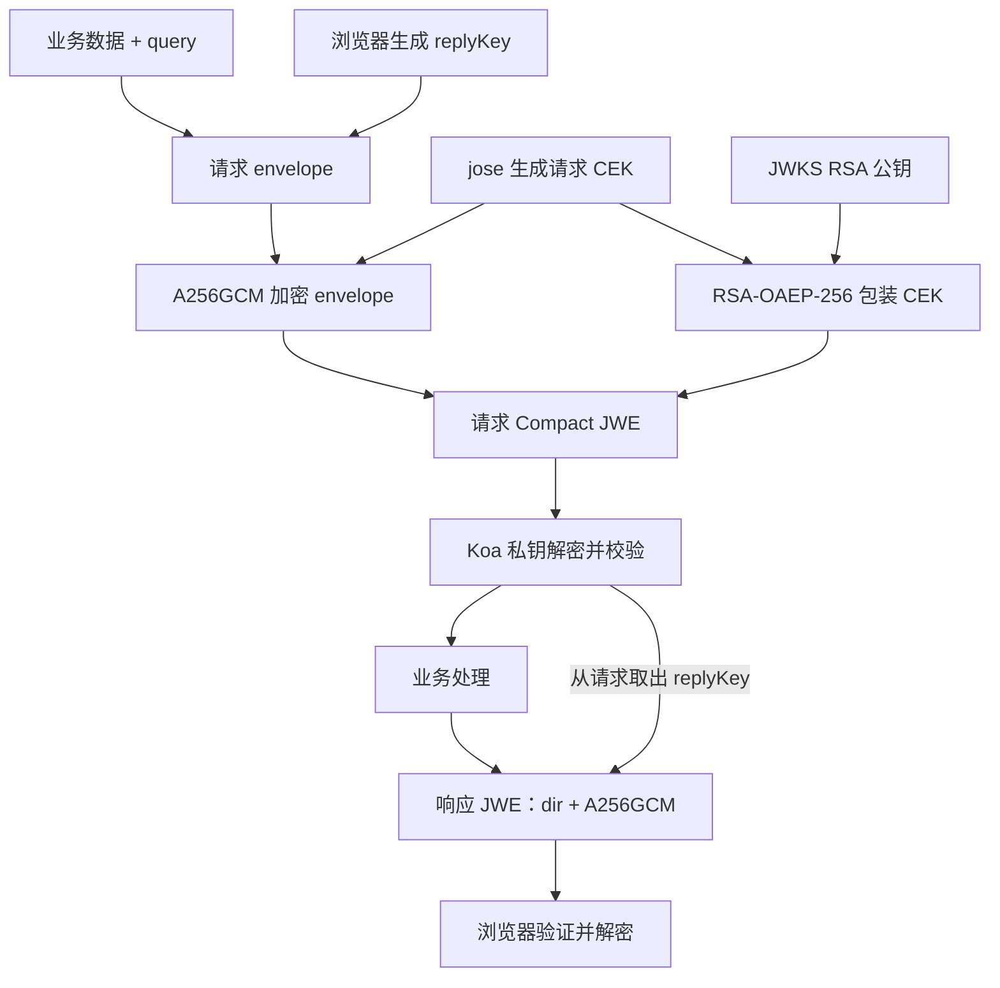
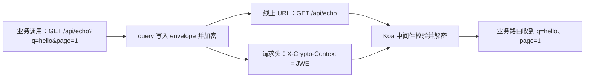
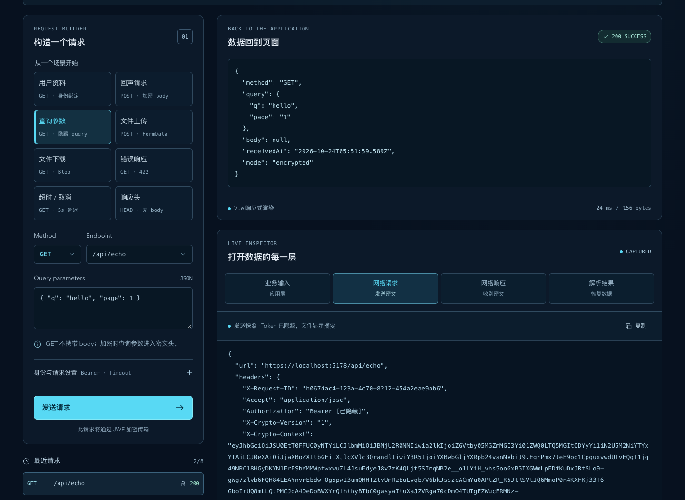
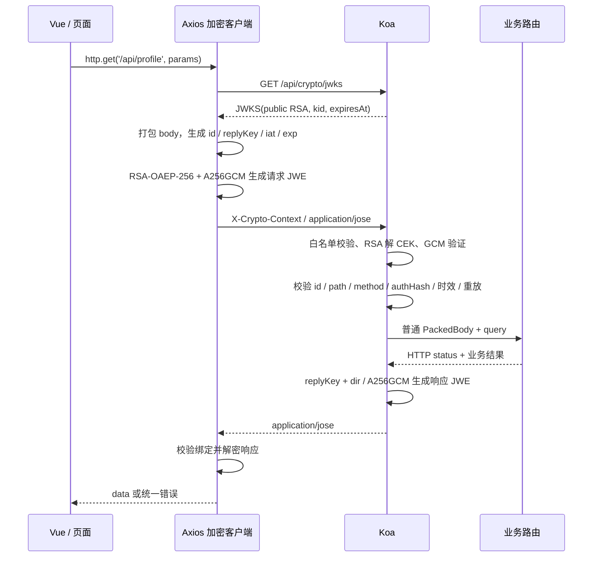

# HTTPS 都上了，业务 JSON 怎么还要自己带锁？Vue + Koa 的 JWE 请求封装、服务端校验与响应解密全流程

> Vue 3 + Axios + Koa。沿着 `cipher-lab` 的真实代码，看一条请求怎样封装、加密、校验、解密，最后让 Vue 拿到普通业务数据。

**项目入口：**[在线交互实验](https://cipher-lab-azure.vercel.app/) · [可交互时序图](https://cipher-lab-azure.vercel.app/#sequence) · [GitHub 源码](https://github.com/wkylin/cipher-lab)。在线演示可以直接打开，无需登录 Vercel；下文也提供本地运行方式。



*图 1：本地运行的 Cipher Lab。页面上每个阶段都能和后面的协议代码对应起来。*

## 开场：HTTP 200，不代表加密成功

讨论这个方案时，最先遇到的通常是一个很有气势的问题：

> “我们已经上 HTTPS 了，为什么还要把请求再加密一遍？”

这个问题不能用一句“更安全”糊过去。HTTPS 保护的是浏览器和 TLS 对端之间的连接；应用层加密保护的是一段业务载荷，让它在经过网关、代理、日志采集器或内部转发层时，仍然不是一团可以随手打印的 JSON。

但应用层加密也不是安全魔法：浏览器最终必须拿到明文并渲染，所以拥有页面执行权限的 XSS、恶意扩展和 DevTools 仍然能看到业务数据。认证、授权、HTTPS 仍然需要保留。我们要解决的是“载荷在应用链路中如何被可靠地封装、验证、解密和恢复”，不是把浏览器变成保险箱。

`cipher-lab` 的目标很朴素：同一个 Vue + Axios 客户端和同一组 Koa 路由，可以切换明文和应用层加密；页面还能把请求前的数据、线上真正传输的密文、服务端处理后的数据和最终响应串起来展示。这样讨论安全时，至少不用对着一张架构图猜“这里到底发生了什么”。

## 1. 先把问题说清楚：我们究竟保护什么

本项目的威胁模型是：业务请求可能经过不希望直接看到业务 body 的中间层。我们希望中间层看见必要的 HTTP 元数据，却看不见 envelope 内的 query、body、认证绑定信息和响应业务数据。

协议明确不承诺以下事情：

- 不隐藏 HTTP method、path、状态码、包大小、时间和未放入密文的请求头。
- 不替代 TLS。JWKS 公钥的真实性依赖同源 HTTPS；如果公钥被中间人替换，浏览器会很礼貌地把密文送给攻击者。
- 不替代登录和授权。能用公钥生成合法 JWE，不等于拥有访问接口的权限。
- 不防止浏览器自身被攻破。页面能解密，页面执行环境就能看到明文。

这几条看起来像“免责声明”，其实是协议边界。边界不写清楚，后面每个安全结论都会长出一条腿，跑到不该去的地方。

## 2. 四种密钥，四个职责

协议名字是 `cipher-lab/1`。这里没有一把“万能密钥”，因为万能密钥通常意味着大家都不知道它到底在万能什么。

| 密钥 | 谁生成 | 生命周期 | 用途 |
| --- | --- | --- | --- |
| RSA 公私钥 | Koa 进程启动时 | 当前进程 | 公钥通过 JWKS 给浏览器；私钥解开请求 JWE 中的 CEK |
| 请求 CEK | `jose` 每次生成 | 单个请求 | 用 AES-256-GCM 加密请求 envelope |
| `replyKey` | 浏览器每次请求随机生成 | 单个请求往返 | 服务端用它加密本次响应 |
| GCM IV / tag | `jose` 每次生成 | 单次 JWE | 为本次加密提供 IV，并用 tag 验证密文完整性 |



*图 2：请求 CEK 只负责请求加密；`replyKey` 藏在请求密文里，到服务端后才用于加密响应。*

客户端不会把私钥、CEK 或 `replyKey` 放进 trace、Vue 状态或 `localStorage`。请求结束后还会调用 `replyKey.fill(0)`，但 JavaScript 垃圾回收和密码库内部复制意味着：这不是“内存已被数学证明擦除”，只是减少一份我们自己持有的引用。

### 为什么要混合加密

RSA 适合保护小东西，不适合直接扛着一整份文件跑马拉松；AES-GCM 适合大数据和完整性校验，但双方必须先安全地拿到同一把 AES 密钥。

所以请求采用经典混合方案：

1. `jose` 生成随机 CEK。
2. 用 CEK 通过 `A256GCM` 加密整个请求 envelope。
3. 用服务端 RSA 公钥通过 `RSA-OAEP-256` 加密 CEK。
4. 把二者装进 Compact JWE。

Compact JWE 的五段是：

```text
protected_header.encrypted_content_key.iv.ciphertext.authentication_tag
```

它是加密格式，不是签名 JWT。JWE 的 protected header 本身可见，但会参与完整性保护；看到 `alg` 和 `enc` 不等于看到业务内容。

## 3. 请求从业务数据到密文：浏览器端完整流程

下面以带 `Authorization: Bearer demo-token` 的 `GET /api/profile?section=basic` 为例。代码主要位于 [`src/lib/http.ts`](../src/lib/http.ts) 和 [`src/lib/body.ts`](../src/lib/body.ts)。

### 第一步：先把各种 body 装进同一个盒子

AES 加密的是字节，业务却可能给我们 JSON、文本、`FormData`、文件或 `ArrayBuffer`。客户端先把它们转成 `PackedBody`，再进入加密层：

```ts
type PackedBody =
  | { kind: 'empty' }
  | { kind: 'json'; value: unknown }
  | { kind: 'text'; value: string; contentType: string }
  | { kind: 'binary'; base64: string; contentType: string; filename?: string }
  | { kind: 'form'; entries: Array<
      { name: string; value: string } |
      { name: string; base64: string; filename: string; contentType: string }
    > }
```

文件和二进制先编码成无填充 Base64URL，只是为了让任意字节可以安全地放进 JSON；Base64URL 本身没有保密性。解码后的业务内容最多 1 MiB，线上 JWE 最多 2 MiB，避免把“教学用缓冲协议”误包装成“大文件流式传输方案”。

`FormData` 的字段顺序、同名字段和文件名都会保留。这样明文模式和加密模式进入业务路由时，仍然是同一套语义，而不是加密一次就顺手把表单改成了另一种表单。

### 第二步：通过同源 HTTPS 取 JWKS

客户端首次加密请求会访问：

```http
GET /api/crypto/jwks
Accept: application/json
```

服务端返回当前公钥、`kid`、协议 profile 和过期时间。客户端会检查：

- `profile` 必须是 `cipher-lab/1`。
- 只能有一个与 `activeKid` 匹配的 RSA 加密公钥。
- `alg` 必须是 `RSA-OAEP-256`，`use` 必须是 `enc`。
- 模数至少 2048 位，且 JWKS 不能夹带私钥字段 `d`、`p`、`q` 等。
- `expiresAt` 不能已经过期。

公钥会短暂缓存，但不超过服务端声明的有效期。JWKS 不走业务加密，否则会遇到“为了取解密公钥，先要解密取公钥”的递归笑话。

### 第三步：生成请求上下文

客户端在真正发请求前生成 request ID、时间窗口和独立的 `replyKey`，并且先固定 Authorization 的快照。认证头的摘要不是 token，也不代替服务端鉴权，它只负责把“这份密文是和哪个认证上下文一起生成的”绑定起来。

```json
{
  "v": 1,
  "id": "随机 request ID",
  "iat": 1800000000,
  "exp": 1800000120,
  "method": "GET",
  "path": "/api/profile",
  "query": "section=basic",
  "authHash": "SHA-256(完整 Authorization 头，Base64URL)",
  "replyKey": "32 字节随机值，Base64URL",
  "body": { "kind": "empty" }
}
```

请求有效期是 120 秒，允许 30 秒时钟偏差。`id`、method、path 和 query 都在 envelope 内，不再只相信 URL 上那一份容易被改写的上下文。

### 第四步：让 `jose` 负责 JWE，别手搓密码学

核心代码可以缩成这样：

```ts
const compact = await new CompactEncrypt(
  encoder.encode(JSON.stringify(envelope)),
)
  .setProtectedHeader({
    alg: 'RSA-OAEP-256',
    enc: 'A256GCM',
    kid: serverKey.kid,
    typ: 'cipher-lab-request+jwe',
    cty: 'application/json',
  })
  .encrypt(serverKey.key)
```

这段代码的重点不是“调用了一个很长的 API”，而是算法白名单和类型标记都写进了协议。服务端不会因为“能解开”就接受任意 JWE，而是要求 `alg`、`enc`、`typ`、`cty`、`kid` 完全符合约定。

### 第五步：按 HTTP 语义选择承载位置

本协议规定 GET、HEAD、OPTIONS 不携带业务 body，所以请求 JWE 放进 `X-Crypto-Context`，原 URL query 会被清空。POST、PUT、PATCH、DELETE 则把 JWE 放入 body：

```http
X-Crypto-Version: 1
X-Request-ID: <request id>
X-Crypto-Context: <Compact JWE>       # GET / HEAD / OPTIONS
```

或者：

```http
Content-Type: application/jose          # 有 body 的方法
X-Crypto-Version: 1
X-Request-ID: <request id>

<Compact JWE>
```

请求头上下文限制为 8 KiB，整体线上载荷限制为 2 MiB。头不是无限大的抽屉，查询参数一多就会把代理和浏览器一起惹毛；大数据应该选择允许 body 的方法。

拿 `GET /api/echo?q=hello&page=1` 具体看一次：



*图 3：URL 上看不到 query；密文在请求头里，Koa 解密后把参数还给业务路由。*



*图 4：真实运行截图。左侧输入了 `q` 和 `page`；右侧网络快照的 URL 没有查询串，服务端响应却恢复了这两个参数。*

## 4. Koa 收到密文后，先验货，再交给业务

服务端代码位于 [`server/app.ts`](../server/app.ts)。Koa 中间件把“协议处理”和“业务路由”分成两层：业务函数只接触已经恢复好的 `PackedBody`，不需要知道 JWE 的五段长什么样。

### 4.1 先判断是不是加密请求

服务端通过 `X-Crypto-Version`、`X-Crypto-Context` 和 `Content-Type: application/jose` 判断加密模式。`/api/crypto/jwks` 和 `/api/health` 是协议基础设施，先单独处理；其余 API 必须通过方法白名单。

### 4.2 检查 protected header，再解密

解密前先解析 header，并严格限制算法：

```ts
const header = decodeProtectedHeader(compact)
if (
  header.alg !== 'RSA-OAEP-256' ||
  header.enc !== 'A256GCM' ||
  header.typ !== REQUEST_TYP ||
  header.cty !== 'application/json' ||
  header.kid !== kid ||
  Object.keys(header).some(key =>
    !['alg', 'enc', 'typ', 'kid', 'cty'].includes(key))
) {
  throw new HttpError(400, '无法验证加密请求')
}

const decrypted = await compactDecrypt(compact, privateKey, {
  keyManagementAlgorithms: ['RSA-OAEP-256'],
  contentEncryptionAlgorithms: ['A256GCM'],
})
```

解密成功也只是拿到了“可能合理的 JSON”。随后还要用共享的 Zod schema 校验 envelope，确认字段类型、字符串格式、方法和 body 结构都在协议范围内。密码学验证解决“内容有没有被改”，schema 验证解决“内容是不是我们认识的东西”；两者不能互相代班。

### 4.3 做上下文绑定和防重放

服务端拿到 envelope 后，会继续检查：

1. `replyKey` 必须恰好是 32 字节的规范 Base64URL。
2. envelope 里的 `id` 必须等于 `X-Request-ID`。
3. envelope 里的 method、path 必须等于当前 HTTP 请求。
4. URL 不能再带 query，真正的 query 必须来自密文 envelope。
5. `exp` 不能过期，`iat` 不能超出时钟偏差，窗口不能超过 120 秒。
6. `authHash` 必须等于当前 Authorization 头的 SHA-256 摘要。
7. request ID 只能使用一次，过期 ID 会从重放缓存中清理。

最后才把 `envelope.body` 交给业务层。一个 JWE 能被解开，只证明密文完整并且持有对应私钥；它还没有证明“这次请求的路径、认证、时间和唯一性都正确”。

### 4.4 为什么错误路径也要分层

解密和结构校验全部失败时，服务端还不知道可信的 `replyKey`，只能返回有限的明文协议错误，例如“无法验证加密请求”。客户端在加密模式下会拒绝这种明文降级，不会看到失败就偷偷改发明文。

一旦 envelope 已经成功解密并拿到可信 `replyKey`，后续的过期、重放、认证绑定、业务校验和业务异常都可以加密返回。这个分界点很重要：错误响应不是协议的后门。

## 5. 响应不是“把请求解开后原样扔回去”

服务端把业务结果封装成响应 envelope：

```json
{
  "v": 1,
  "id": "对应请求 ID",
  "iat": 1800000005,
  "method": "GET",
  "path": "/api/profile",
  "status": 200,
  "body": {
    "kind": "json",
    "value": { "code": 0, "message": "ok", "data": { "name": "Ada Chen" } }
  },
  "headers": {}
}
```

响应使用请求中携带的 `replyKey`：

```ts
const compact = await new CompactEncrypt(
  encoder.encode(JSON.stringify(response)),
)
  .setProtectedHeader({
    alg: 'dir',
    enc: 'A256GCM',
    typ: 'cipher-lab-response+jwe',
    cty: 'application/json',
  })
  .encrypt(Buffer.from(envelope.replyKey, 'base64url'))
```

`dir` 表示直接使用双方已经持有的对称密钥，所以响应 JWE 的第二段 encrypted content key 为空。响应没有复用请求 CEK，因为两个方向使用独立密钥，职责更清楚，也避免把“请求加密密钥”变成整个往返的万能钥匙。

客户端收到响应后按固定顺序执行：

1. 检查 `X-Crypto-Version`、`X-Request-ID`、`Content-Type` 和是否存在密文。
2. 用本次请求的 `replyKey` 做 `dir + A256GCM` 解密。
3. 校验响应 `typ`、`cty` 和 header 白名单。
4. 用 Zod 校验响应 envelope。
5. 比对 request ID、method、path、HTTP status 和时间。
6. 恢复 JSON、文本、Blob 或 `ArrayBuffer`。
7. 先判断 HTTP 错误和业务 `code`，再把 `data` 交给 Vue。

因此，解密成功不等于业务成功。`/api/error` 返回 HTTP 422 和业务码 42201 时，响应仍然是合法加密响应，但客户端最终仍会抛出业务错误。密码学通过和业务成功，是两张不同的成绩单。

HEAD 没有响应 body，服务端把响应 JWE 放到 `X-Crypto-Response`；客户端从响应头取出并执行同样的校验。HTTP 语义没有因为加密而被偷偷改写。

## 6. 完整时序图，串起整条链路



页面组件只调用 `http.get()`、`http.post()`，不需要在每个按钮旁边重复写一遍密码学。加密层是传输适配器，业务层仍然面对普通对象，这正是封装的价值：复杂性集中在一个可审计的位置。

上面是静态版本。[在线时序图](https://cipher-lab-azure.vercel.app/#sequence) 可以直接打开，切换七种 HTTP 方法、展开异常分支，并导出 SVG。

## 7. 明文模式不是“把安全关掉就算了”

项目支持明文模式，用来做对照和故障定位。明文模式仍然使用 HTTPS，仍然走同一个 Axios 客户端、同一组 Koa 路由和同一套业务校验，只跳过 JWE 封装：

| 项目 | 明文模式 | 加密模式 |
| --- | --- | --- |
| query | 留在 URL | 移入 envelope，URL 清空 |
| 写请求 body | 原生 JSON / 文本 / 表单 / 二进制 | `application/jose` |
| GET / HEAD / OPTIONS | 无 body，普通参数在 URL | `X-Crypto-Context` |
| 响应 | 原生数据 | `replyKey` 加密的响应 JWE |
| 失败处理 | 普通 HTTP / JSON 错误 | 能拿到 `replyKey` 后，错误也加密 |

加密请求收到普通 JSON、缺少协议头或响应绑定不匹配时，客户端直接失败，不会自动降级。自动降级很方便，方便到攻击者只需要制造一次解密错误，就能把安全模式变成装饰品。

## 8. 常见失败，和为什么不能“重试一下”

### JWE 被改了

GCM authentication tag 校验失败，客户端或服务端拒绝解密。不要先解析一部分明文再决定是否可信，认证标签通过之前，密文就是一串未经验证的字节。

### request ID 重复

服务端返回 409。协议的防重放缓存只解决“同一个加密请求不要重复接受”，不等于业务幂等。支付、扣库存等有副作用操作仍需要业务幂等键和持久化状态。

### 超时或取消

浏览器的 `AbortSignal` 只终止客户端等待，不能保证服务端没有执行完操作。对于有副作用的请求，超时后不能盲目重新生成 JWE 再发一次；应该由业务幂等机制决定是否可以安全查询或重试。

### 服务端换了密钥

当前客户端在非业务错误的协议失败后会清掉缓存公钥，下一次显式请求重新获取 JWKS，但不会自动重放原请求。这样可以应对热重启或密钥轮换，又不会把一个可能已经执行的 POST 偷偷再提交一次。

### 错误响应解密成功了，但页面仍然报错

这是正确行为。响应解密和绑定校验只证明本次响应符合协议且内容未被改；HTTP 401、422 或业务 `code !== 0` 仍然要进入错误分支。

## 9. Serverless 的冷启动，顺便给协议上了一课

这个项目可以部署到 Vercel，Koa 通过 `app.callback()` 包装成 Node Function。部署本身不是协议重点，但运行环境会暴露几个必须正视的边界：

- `createApp()` 启动时生成 RSA 密钥。不同实例、冷启动或重新部署可能拥有不同的 `kid` 和私钥。
- `seen` 防重放记录是单进程 `Map`。扩容后，另一实例看不到之前实例的 request ID。
- 演示用的 profile 状态也在内存里，实例重启会恢复初始资料。

教学项目这样做是为了让密钥生命周期可见；生产系统需要把 RSA 私钥放入 KMS 或密钥存储，设计 `kid` 轮换和旧钥匙短暂兼容，把防重放记录放进共享且原子化的短期存储，并把业务状态放入真正的数据库。否则你得到的是“每个实例各自很认真地安全”，合起来却像几间互不通电话的保安室。

## 10. 怎么验证整条链路

先在本地启动：

```bash
npm install
npm run dev
```

然后做协议基础检查。本地首次生成的是自签证书，以下 `--insecure` 只用于本机演示；使用受信任证书时去掉它：

```bash
curl --insecure -i https://localhost:5178/api/health
curl --insecure -sS https://localhost:5178/api/crypto/jwks | jq
npm run typecheck
npm run build
```

在页面里切换“应用层加密”，请求 `/api/echo`、`/api/profile`、`/api/upload`、`/api/download` 和 `/api/error`，观察四个快照：

1. **业务数据**：还没有加密的 JSON、表单或文件。
2. **网络请求**：真正发出去的 header 和 Compact JWE。
3. **网络响应**：HTTP status、协议头和响应 JWE。
4. **页面可用数据**：验证、解密、解包之后交给 Vue 的结果。

在线演示入口放在文首；它适合观察协议和故障路径，不应被当作生产密钥管理、分布式重放防护或真实身份系统的替代品。

## 11. 阅读源码的最短路线

想从代码而不是页面开始，可以按这个顺序读：

1. [`shared/protocol.ts`](../shared/protocol.ts)：常量、方法白名单、PackedBody 和 Zod schema。
2. [`src/lib/body.ts`](../src/lib/body.ts)：JSON、文本、表单、文件怎样统一装箱。
3. [`src/lib/http.ts`](../src/lib/http.ts)：JWKS、公钥缓存、请求 JWE、响应解密、错误和取消。
4. [`server/app.ts`](../server/app.ts)：Koa 解密中间件、上下文绑定、重放检查和响应 JWE。
5. [`src/components/SequenceDiagram.vue`](../src/components/SequenceDiagram.vue)：把协议流程画成可交互的时序图。
6. [`docs/PROTOCOL.md`](./PROTOCOL.md)：密钥职责、HTTP 承载、限制和安全边界的完整说明。

## 结尾：加密完成的标志，不是页面出现了一把锁

一条完整的应用层加密链路至少要回答这些问题：公钥从哪里来？每次请求的密钥是谁生成的？业务 body 如何保留原语义？GET 没有 body 时密文放哪里？服务端如何确认密文属于当前路径和认证上下文？响应如何回到正确的请求？解密失败、业务失败、重放和超时分别怎么处理？密钥轮换后会不会为了“重试成功”而重复执行副作用？

如果这些问题没有答案，页面上的锁图标更像装饰；如果每个答案都能在代码、schema 和失败测试里找到，才算真正把应用层加密跑通。

这也是这个实验项目最想展示的东西：密码学算法只是链路中的一段。真正难的是把密钥、数据语义、HTTP 规则、认证上下文、错误处理和运行环境放进同一个严谨的协议里，然后让业务代码可以安静地继续做业务。

## 延伸项目：把工程边界带进后台应用

如果你也在做后台应用，我还开源了独立项目 [Pro React Admin](https://github.com/wkylin/pro-react-admin)。它把多应用、权限与导航、类型化 DataProvider、组件工作区放进一套可运行的 React 管理端工程。本文拆开一条请求给你看；那个项目更适合研究一整个后台怎样持续扩展。

[在线预览 Pro React Admin](https://pro-react-admin.vercel.app/) · [查看源码并 Star](https://github.com/wkylin/pro-react-admin) · [提交 Issue](https://github.com/wkylin/pro-react-admin/issues)
